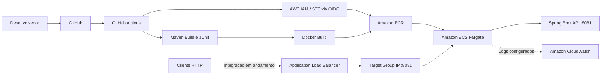
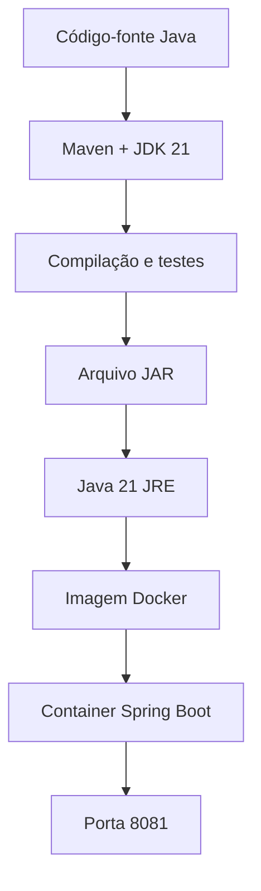
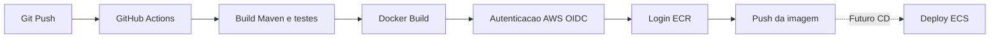

# 🚀 DevOps AWS API

**Java 21 | Spring Boot | Docker | CI/CD | AWS | SRE**


## 📌 Sobre o projeto

O **DevOps AWS API** é um projeto prático voltado ao desenvolvimento backend, automação de infraestrutura, integração contínua, entrega contínua, computação em nuvem e confiabilidade de sistemas (SRE).

A aplicação foi desenvolvida utilizando Java 21 e Spring Boot, com testes automatizados, versionamento Git e containerização Docker utilizando a estratégia Multi-stage Build.

A aplicação já foi implantada no Amazon ECS Fargate, com publicação automatizada de imagens no Amazon ECR via GitHub Actions e autenticação federada OIDC. A integração com o Application Load Balancer e a evolução das práticas de SRE estão em andamento.

## 🎯 Objetivos

- Desenvolver uma API REST utilizando Java e Spring Boot.
- Implementar testes automatizados com JUnit e MockMvc.
- Aplicar boas práticas de versionamento com Git e GitHub.
- Containerizar a aplicação utilizando Docker.
- Automatizar processos de build, testes e deploy.
- Implantar a aplicação na AWS.
- Implementar práticas de observabilidade e SRE.

## 🏗️ Arquitetura do projeto



As linhas tracejadas representam integrações configuradas ou em andamento, ainda pendentes de validação operacional. A API já respondeu com sucesso pelo IP público da tarefa ECS. O deploy inicial foi realizado pelo console AWS; a automação do deploy ECS permanece pendente.

## 🛠️ Stack tecnológica

| Categoria | Tecnologia | Status |
|---|---|---|
| Linguagem | Java 21 | Implementado |
| Framework | Spring Boot 4.2.0 | Implementado |
| API REST | Spring Web MVC | Implementado |
| Build | Apache Maven | Implementado |
| Testes | JUnit 5 e MockMvc | Implementado |
| Versionamento | Git e GitHub | Implementado |
| Containers | Docker | Implementado |
| Build de containers | Multi-stage Build | Implementado |
| IDE | IntelliJ IDEA | Utilizado |
| CI/CD | GitHub Actions | Implementado (CI e publicação ECR) |
| Container Registry | Amazon ECR | Implementado |
| Orquestração | Amazon ECS Fargate | Implementado |
| Observabilidade | Amazon CloudWatch | Logs configurados; validação pendente |
| Autenticação federada | IAM / STS / OIDC | Implementado |
| Balanceamento | Application Load Balancer | Criado; integração pendente |
| Rede | VPC e Security Groups | Implementado |

## 📂 Estrutura do projeto

```text
raiz-do-repositorio/
├── .github/
│   └── workflows/
│       └── ci.yml
├── .gitignore
└── devpos-aws-api/
    ├── .mvn/
    ├── src/
    │   ├── main/
    │   │   ├── java/
    │   │   │   └── com/devops/devpos_aws_api/
    │   │   │       ├── DevposAwsApiApplication.java
    │   │   │       └── controller/
    │   │   │           └── HelloController.java
    │   │   └── resources/
    │   │       └── application.properties
    │   └── test/
    │       └── java/
    │           └── com/devops/devpos_aws_api/
    │               ├── DevposAwsApiApplicationTests.java
    │               └── controller/
    │                   └── HelloControllerTest.java
    ├── .dockerignore
    ├── .gitattributes
    ├── .gitignore
    ├── Dockerfile
    ├── mvnw
    ├── mvnw.cmd
    ├── pom.xml
    └── README.md
```

## ⚙️ Executando localmente

### Pré-requisitos

- Java JDK 21
- Git
- Docker Desktop
- IntelliJ IDEA (opcional)
- Maven Wrapper

### Configuração da aplicação

Arquivo `src/main/resources/application.properties`:

```properties
server.port=8081
```

### Executar com Maven no Windows

```powershell
.\mvnw.cmd spring-boot:run
```

### Executar com Maven no Linux

```bash
./mvnw spring-boot:run
```

### Acessar a aplicação

```text
http://localhost:8081/hello
```

## 🌐 Documentação da API

| Método | Endpoint | Descrição | Status |
|---|---|---|---|
| GET | `/hello` | Verifica a resposta da aplicação | 200 OK |

### Exemplo de requisição

```bash
curl http://localhost:8081/hello
```

### Resposta esperada

```text
Olá! Minha API DevOps AWS está funcionando!
```

## 🧪 Testes automatizados

A aplicação possui testes automatizados utilizando JUnit 5 e MockMvc, permitindo validar o comportamento do endpoint REST sem iniciar um servidor HTTP real.

### Validações implementadas

- Disponibilidade da rota `/hello` no ambiente de testes.
- Validação do status HTTP 200.
- Validação do conteúdo retornado pela API.

### Executar todos os testes no Windows

```powershell
.\mvnw.cmd test
```

### Executar todos os testes no Linux

```bash
./mvnw test
```

### Resultado do teste do controller

| Indicador | Resultado |
|---|---|
| Testes executados | 1 |
| Testes aprovados | 1 |
| Falhas | 0 |
| Status | PASSED |

## 🐳 Containerização com Docker

A aplicação utiliza Docker com a estratégia Multi-stage Build, separando o ambiente de compilação do ambiente de execução.

### Arquitetura do container



### Dockerfile

```dockerfile
# Stage 1 - Build
FROM maven:3.9-eclipse-temurin-21 AS build

WORKDIR /app

COPY pom.xml .
COPY src ./src

RUN mvn clean package

# Stage 2 - Runtime
FROM eclipse-temurin:21-jre

WORKDIR /app

COPY --from=build /app/target/*.jar app.jar

EXPOSE 8081

ENTRYPOINT ["java", "-jar", "app.jar"]
```

### Benefícios do Multi-stage Build

- Separação entre compilação e execução.
- Redução do tamanho da imagem final.
- Execução dos testes durante o build.
- Ausência do Maven na imagem de execução.
- Portabilidade entre ambientes.
- Preparação para implantação na AWS.

### Construir a imagem Docker

Execute na pasta que contém o Dockerfile e o pom.xml:

```bash
docker build -t devops-aws-api:1.0 .
```

### Listar imagens disponíveis

```bash
docker images
```

### Executar o container

```bash
docker run -d --name devops-api -p 8081:8081 devops-aws-api:1.0
```

### Verificar containers em execução

```bash
docker ps
```

### Consultar logs da aplicação

```bash
docker logs devops-api
```

### Acompanhar logs em tempo real

```bash
docker logs -f devops-api
```

### Parar o container

```bash
docker stop devops-api
```

### Reiniciar o container

```bash
docker start devops-api
```

### Remover o container

```bash
docker rm devops-api
```

O container deverá estar parado antes da remoção.

### Acessar a API containerizada

```text
http://localhost:8081/hello
```

Certifique-se de que nenhuma outra aplicação esteja utilizando a porta 8081.

## 🔄 CI/CD — GitHub Actions

**Status:** integração contínua e publicação no ECR implementadas; deploy automatizado no ECS pendente.

Workflow: `.github/workflows/ci.yml`, branch `master`.



- Checkout do código e configuração do Java 21.
- Compilação e testes automatizados com Maven.
- Construção da imagem Docker.
- Autenticação AWS via OIDC e credenciais temporárias STS.
- Login e publicação da imagem no Amazon ECR.
- Próxima evolução: atualização automatizada do serviço ECS e verificação de estabilidade.

O erro `sts:AssumeRoleWithWebIdentity` foi investigado mediante diagnóstico da identidade OIDC e resolvido na etapa de autenticação. Não são necessárias chaves AWS permanentes no workflow OIDC.

## ☁️ Infraestrutura AWS

Região: `us-east-1` (Norte da Virgínia).

| Recurso | Configuração | Status |
|---|---|---|
| Amazon ECR | Registro privado de imagens | Implementado |
| ECS Cluster | `devops-aws-cluster` | Ativo |
| ECS Service | `devops-aws-service` | Implantado |
| Task Definition | `devops-aws-task:1` | Ativa |
| AWS Fargate | 0,25 vCPU / 1 GiB | Em execução na validação |
| Contêiner | `devops-api`, Linux/x86_64, porta 8081 | Implementado |
| Rede | VPC, modo awsvpc | Implementado |
| IAM | `ecsTaskExecutionRole` e autenticação OIDC | Implementado |
| Security Group API | `devops-api-sg` | Criado |
| Security Group ALB | `devops-alb-sg` | Criado |
| Target Group | `devops-api-tg`, IP, HTTP:8081 | Criado |
| ALB | `devops-aws-alb`, internet-facing, IPv4 | Criado; integração pendente |
| CloudWatch Logs | `/ecs/devops-aws-task` | Configurado; validação pendente |

### Validação da implantação

O serviço ECS apresentou implantação bem-sucedida, com uma tarefa em execução e nenhuma pendente. O endpoint `/hello` respondeu pelo IP público da tarefa com a mensagem esperada.

```bash
curl http://<IP_PUBLICO_DA_TAREFA>:8081/hello
```

O IP da tarefa pode mudar. Após a integração do ALB, o teste será realizado por seu DNS:

```bash
curl http://<DNS_DO_ALB>/hello
```

### Balanceamento de carga

O ALB foi criado em quatro zonas de disponibilidade. O Target Group utiliza destinos do tipo IP, necessários para tarefas Fargate em modo awsvpc, e verificação de integridade HTTP no caminho `/hello`.

Ainda é necessário confirmar o listener HTTP:80, associar o Target Group ao serviço ECS e validar destinos íntegros e acesso pelo DNS. Após essa validação, remover a regra de acesso direto à API pelo IP pessoal, mantendo a entrada TCP 8081 proveniente do Security Group do ALB.

### Custos do laboratório

Fargate, ALB, IPv4 público, armazenamento ECR e CloudWatch podem gerar cobranças. Ao terminar os testes, reduzir a quantidade desejada de tarefas a zero e excluir o ALB se não for mais necessário. Revisar também imagens e logs armazenados. A redução das tarefas não interrompe as cobranças do ALB.

## 📡 Observabilidade e SRE

**Status: configuração inicial de logs realizada; validação e monitoramento avançado pendentes.**

A evolução do projeto incluirá práticas de Site Reliability Engineering para garantir maior confiabilidade e visibilidade operacional.

- Monitoramento de disponibilidade.
- Health checks com Spring Boot Actuator.
- Monitoramento de latência.
- Monitoramento de erros HTTP.
- Métricas de CPU e memória.
- Centralização de logs.
- Alarmes com Amazon CloudWatch.
- Definição de SLI, SLO e SLA.
- Estratégias de recuperação e rollback.
- Documentação de incidentes.

## 📊 Roadmap

### Fase 1 — Desenvolvimento

- [x] Criação do projeto Spring Boot
- [x] Configuração do Java 21
- [x] Desenvolvimento da API REST
- [x] Configuração da porta 8081
- [x] Validação do endpoint local

### Fase 2 — Versionamento

- [x] Configuração do Git
- [x] Criação do repositório GitHub
- [x] Publicação inicial do código-fonte
- [x] Configuração do .gitignore
- [x] Documentação do projeto

### Fase 3 — Qualidade de software

- [x] Configuração do JUnit
- [x] Implementação do MockMvc
- [x] Teste automatizado do controller
- [x] Validação do status HTTP
- [x] Validação do conteúdo da resposta

### Fase 4 — Docker

- [x] Configuração do Dockerfile
- [x] Configuração do .dockerignore
- [x] Implementação do Multi-stage Build
- [x] Construção da imagem Docker
- [x] Configuração do mapeamento de portas
- [x] Inicialização do container
- [ ] Confirmação final do endpoint containerizado
- [x] Publicação das alterações no GitHub

### Fase 5 — CI/CD

- [x] Configuração do GitHub Actions
- [x] Automação de build
- [x] Automação de testes
- [x] Automação da construção da imagem Docker
- [x] Autenticação AWS via OIDC e publicação automatizada no ECR
- [ ] Configuração do pipeline de deploy automatizado no ECS

### Fase 6 — AWS Cloud

- [x] Configuração do Amazon ECR
- [x] Publicação da imagem Docker
- [x] Configuração do Amazon ECS
- [x] Configuração do AWS Fargate
- [x] Configuração de rede e segurança
- [x] Deploy inicial da aplicação pelo console AWS
- [x] Validação do endpoint na tarefa ECS
- [x] Criação do Target Group e ALB
- [ ] Associação do ALB ao serviço ECS
- [ ] Validação do Health Check e acesso pelo DNS do ALB

### Fase 7 — SRE e Observabilidade

- [ ] Configuração do Spring Boot Actuator
- [x] Configuração inicial do driver de logs CloudWatch
- [ ] Validação dos logs no CloudWatch
- [ ] Monitoramento de métricas
- [ ] Centralização de logs
- [ ] Configuração de alarmes
- [ ] Definição de SLI e SLO
- [ ] Simulação e análise de incidentes

## 🔐 Segurança e boas práticas

### Implementadas

- Exclusão de arquivos desnecessários do versionamento.
- Configuração do .gitignore.
- Configuração do .dockerignore.
- Separação dos ambientes de build e runtime.
- Testes automatizados.
- Versionamento da imagem Docker.
- Autenticação AWS com GitHub Actions via OIDC e credenciais temporárias.
- Controle de acesso de rede com Security Groups.

### Planejadas

- Execução do container com usuário não privilegiado.
- Revisão do princípio do menor privilégio com IAM.
- HTTPS com certificado ACM e restrição do acesso direto à tarefa.
- Análise de vulnerabilidades em imagens Docker.
- Gerenciamento de variáveis de ambiente.
- Monitoramento e alertas operacionais.

## 📚 Conhecimentos aplicados

- Desenvolvimento backend com Java.
- APIs REST com Spring Boot.
- Testes automatizados.
- Versionamento de código.
- Containerização de aplicações.
- Multi-stage Build.
- Gerenciamento de imagens e containers.
- Análise de logs e troubleshooting.
- Fundamentos de DevOps e SRE.
- Integração contínua com GitHub Actions.
- Autenticação federada IAM/OIDC e troubleshooting.
- Implantação de containers com ECR e ECS Fargate.
- Configuração de VPC, Security Groups, Target Group e ALB.

## 👨‍💻 Autor

**Ailton Ferreira da Cruz Junior**

Projeto desenvolvido para aprimoramento profissional nas áreas de Software Engineering, DevOps, Cloud Computing e Site Reliability Engineering.

GitHub: [Ailton-Tech](https://github.com/Ailton-Tech)

## 📄 Licença

Licença a definir.

---

**Status:** Em desenvolvimento.

**Próxima etapa:** Associar o ALB ao serviço ECS, validar Health Check e DNS, e evoluir para deploy automatizado e observabilidade.
